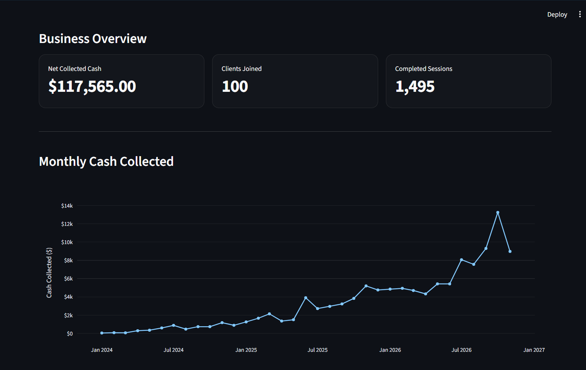
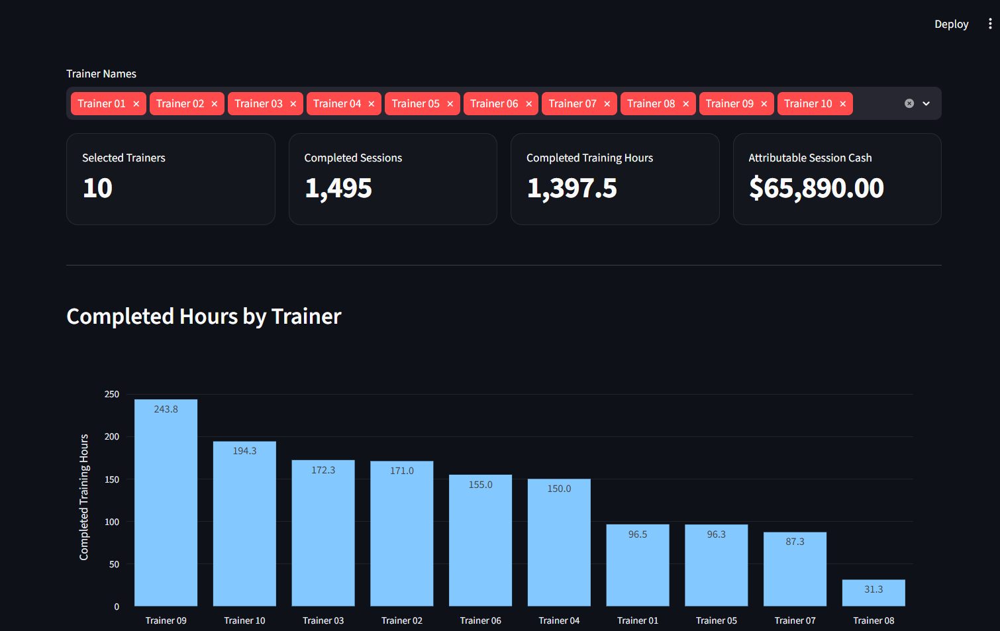

# Personal Training Analytics Platform

A Python-based business intelligence platform designed to help personal trainers, fitness studios, and gym owners analyze business performance through automated data processing, interactive dashboards, and downloadable reports.

The platform transforms raw business data into actionable insights about cash collection, client retention, training activity, and trainer performance.

**Technologies:** Python | pandas | Streamlit | Plotly | pytest

**Project Status:** Version 1 — Core Development Complete

## Live Dashboard

[Launch the Personal Training Analytics Platform]
(https://personal-training-analytics.streamlit.app/)

---

## Project Overview

The Personal Training Analytics Platform is an end-to-end Python data analytics project developed to demonstrate how business intelligence can be applied to the personal training industry.

The application allows users to import business datasets, standardize column names, validate records, calculate performance metrics, and explore results through an interactive Streamlit dashboard.

The platform follows a modular architecture that separates data processing, validation, analytics, visualization, and reporting into independent Python components.

The demonstration environment uses synthetic business data representing 100 personal training clients.

### Project Objectives

- Automate the processing and analysis of personal training business data.
- Provide meaningful financial, client, session, and trainer performance metrics.
- Reduce manual spreadsheet analysis.
- Allow businesses to upload and analyze their own CSV datasets.
- Present business performance through interactive visualizations.
- Generate downloadable business reports.
- Establish a foundation for future predictive analytics and database integration.

---

## Dashboard Preview

### Business Overview



The Business Overview dashboard displays key performance indicators, including net cash collected, clients acquired, and completed training sessions.

An interactive monthly cash collection chart allows users to examine financial performance over time.

### Trainer Analytics



The Trainer Analytics dashboard provides insight into individual trainer performance.

Users can select trainers by name and analyze completed sessions, total training hours, and directly attributable session cash collection.

Interactive visualizations allow comparisons across individual trainers and the overall training team.

---

## Key Features

### 1. Business Overview

Provides a high-level summary of business performance.

**Metrics include:**
- Net cash collected
- Total clients acquired
- Completed training sessions
- Monthly cash collection trends

### 2. Revenue Analytics

Evaluates business payment activity and cash collection performance.

**Features include:**
- Net cash collected
- Monthly cash collection
- Cash collection by payment type
- Month-over-month growth
- Cash collected per client
- Refund analysis
- Interactive financial visualizations

Net cash collected is calculated using completed payment transactions minus completed refunds. It represents cash collection rather than accounting profit.

### 3. Client Analytics

Analyzes client acquisition, membership activity, and engagement.

**Features include:**
- Monthly client acquisition
- Client status distribution
- Membership cancellations
- Membership cohort retention
- Pay-per-session client inactivity indicators

Membership cohort retention measures the continuation of eligible membership contracts over time.

Inactivity indicators identify clients who have not completed a training session within a specified period. These indicators are not treated as confirmed client churn.

### 4. Session Analytics

Examines training activity, attendance, and service utilization.

**Features include:**
- Completed training sessions
- Session attendance and completion rates
- Monthly training activity
- Session activity by pricing model
- Training package redemption
- Session status analysis

### 5. Trainer Analytics

Evaluates operational performance across individual trainers.

**Features include:**
- Trainer selection using readable names
- Completed sessions by trainer
- Completed training hours
- Unique clients served
- Monthly trainer activity
- Session completion rates
- Directly attributable session cash collection

Interactive filtering allows users to analyze individual trainers or compare multiple trainers.

### 6. Data Import and Validation

Allows users to upload and analyze their own business datasets.

**Supported datasets:**
- Clients
- Memberships
- Packages
- Sessions
- Payments

**Import workflow:**

1. Upload CSV datasets.
2. Preview uploaded data.
3. Automatically match recognized column names.
4. Manually map unfamiliar columns when necessary.
5. Validate datasets.
6. Review validation errors and warnings.
7. Activate imported data for analysis.

The import pipeline processes uploaded datasets without overwriting the original sample or processed CSV files.

### 7. Business Reporting

Generates downloadable business reports containing summary metrics, charts, and supporting analytical tables.

**Reporting capabilities include:**
- HTML business reports
- Interactive Plotly visualizations
- Revenue analysis tables
- Client analysis tables
- Session analysis tables
- Trainer performance tables
- Individual CSV exports
- ZIP archives containing complete report packages

Reports can be generated through the Streamlit dashboard or directly through the Python reporting module.

---

## Technologies and Libraries

| Technology | Purpose |
|---|---|
| Python | Core application development |
| pandas | Data cleaning, manipulation, and analysis |
| Streamlit | Interactive web application |
| Plotly | Interactive charts and visualizations |
| pytest | Automated validation and analytics testing |
| pathlib | File and directory management |
| HTML | Browser-readable business reports |
| CSV | Data importing, storage, and exporting |
| Git / GitHub | Version control and project distribution |

---

## Project Architecture

The platform follows a modular data analytics workflow:

**Data Generation / CSV Import → Data Cleaning → Validation → Analytics → Visualization → Reporting**

### Data Generation

Synthetic datasets simulate personal training business operations, including client registrations, membership purchases, training packages, scheduled sessions, and financial transactions.

### Data Cleaning

Raw data is standardized and prepared for analysis.

Cleaning operations include data type conversion, date processing, and the preparation of analytical features.

### Data Validation

Validation functions identify problems such as missing required columns, duplicate identifiers, invalid dates, incorrect numerical values, invalid categories, and inconsistent relationships between datasets.

### Analytics Engine

Separate modules calculate business performance metrics using pandas filtering, grouping, aggregation, and time-based analysis.

### Visualization

Reusable Plotly functions standardize chart formatting, labels, spacing, and interactive hover information.

### Reporting

The reporting module combines analytical results into downloadable HTML reports and CSV tables.

---

## Project Structure

```text
personal-training-analytics/
│
├── app/
│   └── dashboard.py
│
├── data/
│   ├── processed/
│   ├── sample/
│   └── templates/
│
├── docs/
│   ├── data_dictionary.md
│   ├── kpi_definitions.md
│   └── requirements.md
│
├── outputs/
│   ├── clients/
│   ├── reports/
│   ├── revenue/
│   ├── sessions/
│   └── trainers/
│
├── screenshots/
│   ├── business_overview.png
│   └── trainer_analytics.png
│
├── src/
│   ├── data_input/
│   │   ├── column_mapper.py
│   │   ├── csv_loader.py
│   │   └── import_pipeline.py
│   │
│   ├── clean_data.py
│   ├── client_analysis.py
│   ├── generate_data.py
│   ├── reporting.py
│   ├── revenue_analysis.py
│   ├── session_analysis.py
│   ├── trainer_analysis.py
│   ├── validation.py
│   └── visualizations.py
│
├── tests/
│   ├── test_analytics.py
│   └── test_validation.py
│
├── .gitignore
├── README.md
└── requirements.txt
```

The `outputs/` directory contains generated analytical reports and is excluded from version control.

The `data/sample/` and `data/processed/` directories contain synthetic demonstration datasets used by the application.

---

## Dataset Description

The platform uses five related datasets representing different aspects of personal training business operations.

| Dataset | Description |
|---|---|
| Clients | Client identifiers, registration dates, status, and trainer assignments |
| Memberships | Membership contracts, start dates, end dates, and cancellations |
| Packages | Training package information and redemption activity |
| Sessions | Scheduled appointments, attendance, duration, and trainer assignments |
| Payments | Payment transactions, refunds, amounts, and payment types |

These datasets are connected through identifiers such as client IDs, trainer IDs, and package IDs.

All demonstration data is synthetic and does not contain real client information.

---

## Data Processing and Methodology

### Data Cleaning

The application uses pandas to read and process CSV datasets.

Data preparation includes:

- Checking column names and data types
- Converting dates into datetime values
- Converting numerical fields into appropriate types
- Standardizing categorical values
- Preparing features for time-based analysis
- Identifying invalid or inconsistent observations

### Data Validation

The validation system checks datasets before they are used for business analysis.

Validation includes:

- Required column verification
- Missing value detection
- Duplicate identifier detection
- Invalid date detection
- Negative or invalid numerical values
- Invalid categorical values
- Referential integrity between related datasets

### Financial Analysis

Financial metrics are calculated from completed payment and refund transactions.

**Net Cash Collected**

Net Cash Collected = Completed Payments − Completed Refunds

**Monthly Cash Collection**

Monthly Cash Collection = Sum of Net Transactions Within Each Month

**Month-over-Month Growth**

Growth (%) = ((Current Month − Previous Month) / Previous Month) × 100

Growth is reported only when the previous month's value provides a valid positive denominator.

### Client Analytics

Client acquisition is calculated by grouping client registration dates into monthly periods.

Membership cohort retention is calculated by determining which eligible memberships remain in force at successive monthly anniversaries.

**Membership Retention (%)**

Retention Rate = (Retained Eligible Memberships / Eligible Memberships) × 100

Only memberships old enough to reach the corresponding anniversary are included in the denominator.

Pay-per-session inactivity is evaluated using the number of days since a client's most recent completed session.

### Session Analytics

Session activity is evaluated using appointment records and their associated statuses.

**Session Completion Rate (%)**

Completion Rate = (Completed Sessions / Total Relevant Sessions) × 100

Additional analyses examine monthly attendance, pricing models, and package redemption activity.

### Trainer Analytics

Trainer performance is evaluated through session records and related financial transactions.

Metrics include completed sessions, training hours, unique clients served, and directly attributable session cash collection.

These metrics describe operational activity and do not represent individual trainer profitability.

---

## Demonstration Results

The following results were generated using the synthetic dataset with a reporting date of November 20, 2026.

| Metric | Result |
|---|---:|
| Total Clients | 100 |
| Net Cash Collected | $117,565 |
| Completed Training Sessions | 1,495 |
| Completed Training Hours | 1,397.5 |
| Attributable Session Cash | $65,890 |
| Trainers Represented | 10 |

These figures demonstrate the functionality of the platform and do not represent actual business performance.

---

## Installation and Setup

### Prerequisites

- Python
- pip
- Git
- A web browser

### 1. Clone the Repository

```bash
git clone https://github.com/etrykk/personal-training-analytics.git
cd personal-training-analytics
```

### 2. Create a Virtual Environment

```bash
python -m venv .venv
```

Activate the environment.

**Windows:**

```bat
.venv\Scripts\activate
```

**macOS / Linux:**

```bash
source .venv/bin/activate
```

### 3. Install Dependencies

```bash
python -m pip install -r requirements.txt
```

### 4. Run the Dashboard

```bash
python -m streamlit run app/dashboard.py
```

The application will typically be available at:

http://localhost:8501

### 5. Select a Dataset

The dashboard supports two data sources:

**Sample Data:** Uses the included synthetic demonstration datasets.

**Imported Data:** Uses CSV datasets uploaded and validated through the Data Import page.

---

## Running Automated Tests

The project uses pytest to verify validation behavior and business analytics calculations.

The initial automated testing suite contains 34 tests.

**Validation testing includes:**
- Missing columns
- Duplicate identifiers
- Invalid dates
- Incorrect numerical values
- Invalid categorical values
- Broken relationships between datasets

**Analytics testing includes:**
- Revenue calculations
- Refund analysis
- Client acquisition
- Membership retention
- Client inactivity
- Session attendance
- Package redemption
- Trainer activity

Run all tests using:

```bash
python -m pytest tests/ -v
```

**Latest verified local result:**

34 passed, 0 failed, 1 noncritical warning.

The warning was related to pandas date-format inference during a validation test.

---

## Generating Business Reports

Business reports can be generated directly through the Streamlit dashboard.

Alternatively, run:

```bash
python src/reporting.py
```

Generated reports are saved to:

```text
outputs/reports/
```

The reporting system generates HTML and CSV outputs that can be reviewed independently of the dashboard.

The Business Reports page also provides downloadable HTML and ZIP report packages.

---

## Technical Documentation

Additional project documentation is available in the `docs/` directory.

### Data Dictionary

[View Data Dictionary](docs/data_dictionary.md)

Documents the structure of the datasets, including column names, data types, identifiers, and relationships.

### KPI Definitions

[View KPI Definitions](docs/kpi_definitions.md)

Provides detailed explanations of the business performance metrics and calculation methodologies used throughout the platform.

### Project Requirements

[View Project Requirements](docs/requirements.md)

Documents the project's functional requirements, analytical objectives, and technical specifications.

---

## Current Limitations

Version 1 is a functional analytics prototype designed for demonstration and further development.

Current limitations include:

- CSV-based data storage
- No persistent relational database
- No account authentication or role-based permissions
- No automated synchronization with external fitness management platforms
- Limited flexibility for different business data structures
- No predictive machine learning models
- No multi-business data isolation
- No production-grade security infrastructure

The platform should be used with synthetic or appropriately authorized data until additional security and privacy controls are implemented.

---

## Planned Version 2 Development

Future development is planned to expand the platform into a more advanced analytics application.

### Predictive Analytics

- Client churn prediction
- Revenue forecasting
- Membership cancellation risk analysis
- Predictive business performance indicators

### Data Infrastructure

- Persistent database integration
- Expanded data import capabilities
- Automated data synchronization
- External API integrations, including Trainerize where supported

### Application Features

- User authentication
- Business account management
- Multi-business data isolation
- Expanded reporting options
- Advanced interactive visualizations
- Additional trainer and client performance metrics

These features are planned enhancements and are not part of the current Version 1 implementation.

---

## Skills Demonstrated

This project demonstrates practical experience in:

- Python programming
- Data cleaning and preprocessing
- Data validation
- Data analysis using pandas
- Business intelligence
- KPI development
- Financial and operational analytics
- Interactive dashboard development
- Data visualization with Plotly
- Automated testing with pytest
- Modular software architecture
- CSV importing and column mapping
- HTML and CSV reporting
- Technical documentation

---

## Project Purpose

The Personal Training Analytics Platform was developed as an independent Python and data analytics portfolio project.

It combines programming, statistical reasoning, and knowledge of personal training business operations to demonstrate how raw operational data can be transformed into meaningful business insights.

The project also establishes a technical foundation for future development involving machine learning, predictive analytics, database systems, and commercial business intelligence applications.

---

## Author

**etrykk**

Independent Python and Data Analytics Project

GitHub: https://github.com/etrykk
